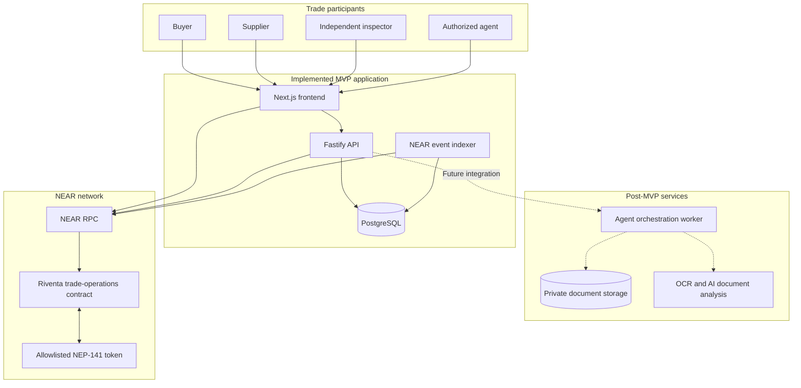
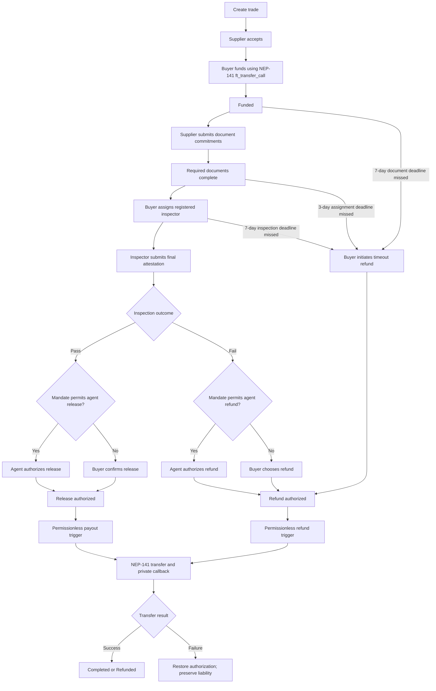

# Riventa

**Confidential Trade Operations and Conditional Settlement for Businesses**

Riventa is an AI-assisted trade-operations platform designed to coordinate cross-border business transactions through buyer-authorized automation, verifiable document commitments, independent inspection, and smart-contract-enforced escrow.

The system is built around a clear separation of authority:

- Buyers define trade terms and the limits under which an authorized agent may act.
- Suppliers accept trade terms and submit required document commitments.
- Independent inspectors attest to inspection outcomes.
- The NEAR smart contract enforces trade state, mandate permissions, budget accounting, escrow liabilities, and settlement.
- Backend services authenticate participants, index blockchain state, and coordinate application workflows without controlling customer funds.
- AI assists with document analysis; it does not authorize financial actions.

## Project status

Riventa has progressed beyond a contract-only prototype. The repository contains a working NEAR smart contract, a Next.js frontend, and a Fastify/PostgreSQL backend with wallet-signature authentication, workspace APIs, and a NEAR indexing pipeline.

This is an MVP/hackathon implementation, not a production trade-finance deployment. The sections below distinguish implemented functionality from remaining work.

### Implemented MVP

**Smart contract**

- Three-administrator configuration with 2-of-3 administrative approval.
- Buyer-created trades and supplier acceptance.
- NEP-141 escrow funding through `ft_transfer_call`.
- Buyer-authorized execution mandates with update, renewal, and revocation.
- Agent-created trades constrained by mandate policy.
- Immutable per-trade mandate policy snapshots.
- Aggregate budget reservation and consumption accounting.
- Supplier document commitments with bounded versions.
- Inspector registration, status management, assignment, and replacement.
- Inspector pass/fail attestations.
- On-chain deadlines for supplier document submission, inspector assignment, and inspection attestation.
- Buyer-only timeout-based escrow recovery with distinct settlement reasons.
- Buyer- or mandate-authorized payout/refund authorization.
- NEP-141 payout and refund transfers with asynchronous callbacks.
- Failed-settlement recovery through retryable authorization and settlement records.

**Backend**

- Fastify API server with environment-based configuration and CORS allowlisting.
- PostgreSQL connection pool and versioned SQL migrations.
- NEAR wallet-signature challenge and verification endpoints.
- Session management, including session lookup and logout.
- HttpOnly session-cookie handling and authenticated route guards.
- Authenticated workspace status, trade list/detail/lifecycle, and mandate read APIs.
- NEAR RPC reads for finalized contract state.
- NEAR event indexing with persisted checkpoints and database projections.
- Graceful server and indexer shutdown.
- Backend tests covering domain, NEAR integration, and workspace behavior.

**Frontend**

- Next.js App Router application and public product website.
- NEAR wallet connection integration.
- Authenticated workspace entry.
- Participant-facing trade workflows.
- Trade creation and activity interfaces.
- Trade lifecycle presentation.
- Supplier acceptance and funding workflows.
- Document commitment and inspector assignment interfaces.
- Inspection status and settlement authorization interfaces where supported by the connected contract.

The frontend and backend are functional MVP components. Their existence does not mean every planned automation, document-intelligence, dispute, or production operations feature is complete.

### Verification

The contract workspace passed the following checks on 9 November 2026:

| Check | Result |
|---|---:|
| Contract unit tests | 95 passed |
| Funding and settlement integration tests | 3 passed |
| NEAR sandbox smoke tests | 1 passed |
| Rust formatting check | Passed |
| WASM-target workspace check | Passed |
| `git diff --check` | Passed |
| **Total contract tests** | **99 passed** |

This is a dated historical verification snapshot. The 99 tests verify the contract workspace, not the entire frontend and backend application.

Run the relevant commands in [Development](#development) to verify the current checkout.

### Not yet implemented or not production-verified

- Complete dispute opening, resolver decisions, and resolver replacement.
- Autonomous agent-worker execution and production-grade orchestration of mandate-authorized actions.
- Private document object storage, OCR, cross-document analysis, and AI document intelligence.
- Live cross-chain settlement through NEAR Intents or Tidepool.
- Full embedded-wallet and cross-chain signing compatibility, including any required Chain Signatures integration.
- Production KYB/business identity verification and compliance integrations.
- Production deployment, independent security audits, operational key management, monitoring, alerting, backups, and incident/recovery procedures.
- Load testing, service-level objectives, and production-scale indexing/reconciliation.

These remain roadmap items. Documentation or interface elements describing a capability do not establish that the capability is implemented.

---

## Table of contents

- [Problem and approach](#problem-and-approach)
- [System architecture](#system-architecture)
- [Trade lifecycle](#trade-lifecycle)
- [Mandates and delegated execution](#mandates-and-delegated-execution)
- [Technology stack](#technology-stack)
- [Smart-contract interface](#smart-contract-interface)
- [Escrow and settlement](#escrow-and-settlement)
- [Document commitments and inspection](#document-commitments-and-inspection)
- [Backend and frontend](#backend-and-frontend)
- [Security model](#security-model)
- [Cross-chain direction](#cross-chain-direction)
- [Repository structure](#repository-structure)
- [Development](#development)
- [Post-MVP roadmap](#post-mvp-roadmap)
- [Limitations and non-goals](#limitations-and-non-goals)

## Problem and approach

Cross-border trade involves multiple independent parties, sensitive commercial documents, inspection requirements, payment conditions, and operational coordination.

Traditional workflows often rely on disconnected communication channels, manual verification, and fragmented records. This makes it difficult to coordinate actions while preserving clear authorization and accountability.

Riventa approaches this problem through programmable trade operations:

1. A buyer creates a trade directly or delegates bounded creation authority through a mandate.
2. The supplier accepts the trade.
3. The buyer funds the contract through an allowlisted NEP-141 token.
4. Required supplier documents are committed to the trade.
5. An assigned inspector submits a final inspection attestation.
6. The buyer or an agent permitted by the trade's mandate snapshot authorizes the applicable payout or refund.
7. Anyone may trigger an already-authorized transfer.
8. The contract records the asynchronous token-transfer result.

The smart contract enforces financial and authorization rules. The frontend provides participant workflows. The backend authenticates users, indexes finalized blockchain data, and serves application projections. Advanced private-document processing and AI analysis remain planned.

## System architecture

Riventa separates authoritative on-chain state from off-chain application services.



### Authority boundaries

| Component | Responsibility | Authority |
|---|---|---|
| NEAR contract | Mandates, trade state, budget accounting, escrow liabilities, inspection records, settlement | Authoritative |
| NEP-141 token | Token balances and transfers | Token ledger |
| Frontend | Participant workflows and transaction preparation | Non-authoritative |
| Backend/API | Wallet authentication, workspace APIs, indexing, projections | Non-authoritative |
| PostgreSQL | Sessions, application metadata, indexer checkpoints, projections | Rebuildable; not escrow authority |
| Agent execution | Future orchestration of permitted actions | Must remain contract-constrained |
| Private storage | Future encrypted document objects | Off-chain evidence storage |
| AI inference | Future document findings and explanations | Advisory only |

The backend, database, frontend, and AI service cannot independently authorize escrow transfers.

## Trade lifecycle

The implemented contract supports the core funding, document, inspection, authorization, and settlement flow.



The contract also supports buyer-initiated timeout recovery when supplier documents, inspector assignment, or inspection attestation miss their defined deadlines.

Dispute handling is part of the wider architecture, but its complete contract workflow is not included in the current verified implementation.

## Mandates and delegated execution

Riventa's mandate layer allows a buyer to authorize an agent to create trades and initiate specific settlement outcomes within explicit constraints.

A mandate binds:

- Buyer identity.
- Authorized agent account.
- Approved supplier.
- Supported payment token.
- Maximum amount per trade.
- Aggregate budget.
- Permitted release/refund outcomes.
- Expiry and policy version.

The buyer creates, updates, renews, or revokes a mandate through buyer-authorized contract calls.

### Budget accounting

For each mandate:

`aggregate_budget >= reserved_budget + consumed_budget`

The contract applies these rules:

- Trade creation reserves the full amount.
- Cancellation before successful funding releases the reservation exactly once.
- Successful funding converts the reservation into consumed budget.
- Failed or rejected funding does not consume budget.
- A post-funding refund does not automatically restore consumed budget.
- Contract-side accounting, not backend calculations, determines available budget.

### Immutable policy snapshots

Every mandate-created trade records the policy version, authorized agent, and settlement permissions that applied when the trade was created.

Later mandate updates do not rewrite existing snapshots.

Revocation prevents new agent-created trades and blocks applicable new agent actions on accepted but unfunded trades. Already-funded trades continue under their recorded policy snapshot.

The agent uses its own NEAR account. It does not sign as the buyer and does not directly control the buyer's escrowed tokens.

## Technology stack

The project distinguishes the implemented application stack from planned extensions.

| Layer | Technology | Status |
|---|---|---|
| Smart contracts | Rust 1.99.1 | Implemented |
| NEAR SDK | `near-sdk` 5.29.1 | Implemented |
| NEAR standards | `near-contract-standards` 5.29.1 | Implemented |
| Integration testing | `near-workspaces` 0.23.0 | Implemented |
| Test token | NEP-141 SDD token contract | Test environment |
| Frontend | Next.js 16.4.2, React 19.2.3, TypeScript 5.9.3 | Implemented MVP |
| Wallet integration | `@hot-labs/near-connect` 0.12.0 | Implemented MVP |
| Backend | Node.js, Fastify 5.6.2, TypeScript 5.9.3 | Implemented MVP |
| Database | PostgreSQL, `pg` 8.16.3 | Implemented MVP |
| Migrations | Versioned SQL migrations | Implemented MVP |
| NEAR indexing | RPC/Data API indexing worker with persisted checkpoints | Implemented MVP |
| OCR and AI | Tesseract.js / Ollama model baseline | Planned |
| Private document storage | Encrypted object/file storage | Planned |
| Agent worker | Mandate-constrained orchestration | Planned |

The root package requires Node.js >=22.20.0 and uses pnpm 11.22.0.

## Smart-contract interface

The current contract is implemented in:

`contracts/trade-operations/src/lib.rs`

The source code is the authority for exact parameter and return types.

### Initialization and administration

| Method | Purpose |
|---|---|
| `new` | Initializes the contract with three administrators and an allowlisted token contract |
| `propose_admin_action` | Proposes an administrative action |
| `approve_admin_action` | Records an administrator's approval |
| `execute_admin_action` | Executes an approved administrative action |
| `expire_admin_proposal` | Removes an expired proposal |
| `get_admin_proposal` | Reads a proposal |
| `get_contract_config` | Reads contract configuration |

Administrative actions use a 2-of-3 approval model.

### Mandates and trade creation

| Method | Purpose |
|---|---|
| `create_mandate` | Creates buyer-authorized agent permissions |
| `update_mandate` | Updates mandate policy |
| `renew_mandate` | Renews mandate validity |
| `revoke_mandate` | Revokes a mandate |
| `get_mandate` | Reads mandate state |
| `get_trade_policy_snapshot` | Reads a trade's stored policy snapshot |
| `create_trade` | Creates a buyer-originated trade |
| `create_trade_under_mandate` | Creates a trade using an authorized mandate |
| `accept_trade` | Allows the named supplier to accept |
| `cancel_trade` | Cancels an eligible unfunded trade |

### Documents and inspection

| Method | Purpose |
|---|---|
| `record_document_commitment` | Records a supplier document commitment |
| `get_document_commitments` | Reads document commitments |
| `are_required_supplier_documents_complete` | Checks required-document completeness |
| `get_inspector` | Reads inspector registration |
| `assign_inspector` | Assigns an eligible registered inspector |
| `replace_inspector` | Replaces an inspector within the allowed limit |
| `submit_inspection_attestation` | Records the assigned inspector's final outcome |
| `get_inspection_record` | Reads inspection information |

### Settlement

| Method | Purpose |
|---|---|
| `authorize_mandated_release` | Authorizes payout under the stored mandate snapshot |
| `authorize_mandated_refund` | Authorizes refund under the stored mandate snapshot |
| `confirm_release` | Records buyer payout confirmation |
| `choose_refund` | Records buyer refund choice |
| `refund_after_timeout` | Allows the buyer to refund escrow after an eligible post-funding deadline expires |
| `release_payment` | Triggers an authorized payout |
| `refund_escrow` | Triggers an authorized refund |
| `on_settlement_transfer_complete` | Processes the private asynchronous transfer callback |
| `get_trade` | Reads trade state |

The token receiver `ft_on_transfer` is implemented through the NEP-141 fungible-token receiver interface.

## Escrow and settlement

### Funding

The buyer funds a trade through the allowlisted token contract's `ft_transfer_call`.

The receiver validates:

- The calling token contract.
- The original token sender.
- The stored buyer identity.
- The trade state.
- The exact required funding amount.
- The funding deadline.
- The contract's pause state.
- The bounded transfer message.

Rejected transfers return the full unused amount through NEP-141 transfer-call resolution. The contract does not manually refund a rejected incoming transfer.

The test configuration uses a fixed funding amount of 10,000 SDD, represented as `10,000,000,000` raw units at six decimals. SDD is a sandbox/test token and does not represent real purchasing power or revenue.

### Outgoing settlement

Payout and refund are separate authorization and execution steps.

1. A buyer or permitted agent establishes the authorization.
2. The contract records a unique settlement ID and pending settlement record.
3. A permissionless caller may trigger the authorized transfer.
4. The contract invokes the NEP-141 token transfer.
5. A private callback validates the promise result and settlement identity.
6. Successful transfers finalize the trade.
7. Failed transfers restore the relevant authorization and preserve the escrow liability for retry.

The callback is protected against stale or replayed settlement results. A missing or unknown promise result must not be interpreted as successful payment.

The agent authorizes within its mandate; the contract itself performs the token transfer.

### Timeout-based escrow recovery

The contract provides a buyer-only recovery path when a required post-funding lifecycle action is not completed within its defined deadline.

| Required action | Deadline begins | Allowed duration |
|---|---|---:|
| Supplier submits all required documents | Successful funding | 7 days |
| Buyer assigns an inspector | Completion of all required supplier documents | 3 days |
| Assigned inspector submits an attestation | Inspector assignment or permitted replacement | 7 days |

Recovery becomes available at or after the relevant deadline. The corresponding lifecycle action is rejected once its deadline has passed.

The buyer may invoke `refund_after_timeout` when an eligible deadline expires. This recovery path is independent of the trade's mandate snapshot, including when refund authority was delegated to an agent.

Timeout refunds:

- Always return escrow to the buyer.
- Use the existing NEP-141 refund settlement and asynchronous callback mechanism.
- Record one of three reasons: `SupplierDocumentsTimeout`, `InspectorAssignmentTimeout`, or `InspectionTimeout`.
- Preserve the timeout reason if the outgoing transfer fails and is retried.
- Do not restore consumed mandate budget.

The inspector assignment deadline starts only after all required documents are complete. A permitted inspector replacement resets the inspection-attestation deadline. Only one replacement is permitted by the existing contract policy.

These recovery rules do not constitute dispute resolution or arbitration.

## Document commitments and inspection

The current contract records supplier document commitments rather than storing document contents on-chain.

The implemented workflow includes:

- Required supplier document commitments.
- A 32-byte commitment requirement.
- Immutable first versions and append-only subsequent versions within the bounded version limit.
- Required-document completeness checks.
- Registered inspector eligibility and status checks.
- Buyer assignment of an active inspector.
- One permitted inspector replacement before attestation.
- Assigned-inspector-only final pass/fail attestation.

Document commitments provide a cryptographic reference to off-chain material. They do **not** independently prove that a document is authentic, legally valid, or factually correct.

The planned document-intelligence layer will manage private document storage, encryption, extraction, deterministic comparisons, and AI-assisted explanations. Those capabilities are not yet part of the verified implementation.

## Backend and frontend

### Backend

The Fastify service is located in `backend/`.

Its implemented MVP responsibilities include:

- Wallet challenge and signature-verification authentication.
- Session management and logout.
- PostgreSQL persistence and SQL migrations.
- Authenticated workspace and trade/mandate read endpoints.
- Reading finalized NEAR contract state through RPC.
- Indexing finalized NEAR blocks/events and persisting checkpoints and projections.
- Health checks and graceful shutdown.

The indexer and database provide application read models. The NEAR contract remains authoritative.

The backend does not custody user keys or independently authorize contract transfers.

### Frontend

The Next.js application is located in `frontend/`.

It provides:

- Public product and marketing pages.
- NEAR wallet connection.
- Authenticated workspace experience.
- Participant-facing trade workflows.
- Trade creation and activity interfaces.
- Trade lifecycle presentation.
- Supplier acceptance and funding workflows.
- Document commitment and inspector assignment interfaces.
- Inspection status and settlement authorization interfaces where supported by the connected contract.

Financial actions still require the appropriate signed NEAR transaction and contract-side authorization.

### API routes

The implemented route families include:

| Route | Purpose |
|---|---|
| `POST /auth/challenge` | Starts wallet login challenge |
| `POST /auth/verify` | Verifies wallet signature and establishes session |
| `GET /auth/me` | Returns the current authenticated session |
| `POST /auth/logout` | Ends the session |
| `GET /workspace/status` | Workspace, contract, and indexer status |
| `GET /workspace/trades` | Lists visible trades |
| `GET /workspace/trades/:tradeId` | Reads a trade |
| `GET /workspace/trades/:tradeId/lifecycle` | Reads documents, inspection, settlement projection, and policy snapshot |
| `GET /workspace/mandates` | Lists mandates |
| `GET /workspace/mandates/:mandateId` | Reads a mandate |

The route implementation is the source of truth for current access checks and response schemas.

## Security model

Riventa is designed around explicit trust boundaries and contract-enforced invariants.

### Authorization

- Buyer actions require the buyer account.
- Supplier acceptance requires the named supplier.
- Inspector attestations require the assigned active inspector.
- Agent actions require the authorized agent and applicable mandate/trade snapshot.
- Administrative actions require the configured multisig threshold.
- Backend sessions and AI output cannot replace contract authorization.

### Escrow integrity

- Only the allowlisted token contract may invoke the funding receiver.
- The original sender must be the buyer.
- Funding must match the required amount and deadline.
- Outgoing settlement must be authorized before execution.
- Failed outgoing transfers preserve the liability and restore the authorization path.
- Allocated escrow is not available for administrative withdrawal.

### Mandate integrity

- The contract validates agent identity and mandate constraints.
- Budget reservations prevent aggregate-budget oversubscription.
- Existing trade snapshots are not rewritten by later mandate changes.
- Revocation does not silently invalidate an already-funded trade.
- The agent cannot directly transfer customer escrow.

### Privacy and identity

- Document contents and evidence files are not stored directly on-chain.
- On-chain commitments are fixed-size hashes.
- Wallet authentication proves control of an account key, not legal identity or KYB status.
- PostgreSQL and backend state are not authoritative escrow records.
- AI findings, when implemented, must remain advisory and may be incorrect or incomplete.

### Deployment assumptions

The contract source has no upgrade method. The deployment design calls for removing the temporary deployer full-access key after deployment and code-hash verification.

These operational deployment controls must be verified on the actual deployed account; source code alone does not prove that a deployed account has no full-access key.

## Cross-chain direction

NEAR Intents is being evaluated as an optional cross-chain asset-routing layer.

The proposed direction is to let users access supported external assets through a wallet experience, route assets through a cross-chain service, and ultimately fund Riventa's existing NEP-141 escrow on NEAR.

This is separate from the core trade and mandate contract.

Tidepool sandbox quote experimentation is not a completed deposit, swap, delivery, or refund.

The following remain unverified or unimplemented:

- End-to-end embedded-wallet signing compatibility.
- Chain Signatures integration.
- Live Intents deposit and outbound settlement.
- Destination-chain transaction and token-transfer verification.
- Replay protection and reconciliation for cross-chain execution.
- Production asset/network support and recovery behavior.

ADR-010 remains proposed. Do not treat cross-chain settlement as a production capability or as a prerequisite for the current NEP-141 escrow workflow.

## Repository structure

```text
riventa/
├── contracts/
│   ├── README.md
│   └── trade-operations/
│       ├── Cargo.toml
│       └── src/
│           ├── lib.rs
│           └── state.rs
├── test-contracts/
│   └── sdd-token/
├── integration-tests/
│   └── tests/
├── backend/
│   ├── migrations/
│   ├── src/
│   │   ├── auth/
│   │   ├── db/
│   │   ├── domain/
│   │   ├── near/
│   │   ├── workspace/
│   │   └── server.ts
│   └── package.json
├── frontend/
│   ├── src/
│   │   ├── app/
│   │   └── components/
│   └── package.json
├── docs/
│   ├── decisions/
│   ├── diagrams/
│   ├── implementation/
│   ├── 01-project-overview.md
│   ├── 02-problem-and-solution.md
│   ├── 03-product-requirements.md
│   ├── 04-system-architecture.md
│   ├── 05-trust-boundaries-and-privacy.md
│   ├── 06-trade-lifecycle.md
│   ├── 07-smart-contract-design.md
│   ├── 08-data-model-and-storage.md
│   ├── 09-security-model-and-invariants.md
│   ├── 10-ai-document-intelligence.md
│   ├── 11-backend-and-integration.md
│   ├── 12-mvp-scope-and-roadmap.md
│   ├── DECISION-REGISTER.md
│   └── INDEX.md
├── package.json
├── pnpm-workspace.yaml
├── Cargo.toml
├── rust-toolchain.toml
└── README.md
```

## Development

### Requirements

- Node.js `>=22.20.0`
- pnpm `11.22.0`
- Rust toolchain `1.99.1` (pinned in `rust-toolchain.toml`)
- `rustfmt` and `clippy` components
- `wasm32-unknown-unknown` target
- PostgreSQL for backend development
- NEAR Sandbox for contract integration tests

### Setup

```bash
git clone https://github.com/Gidy515/Riventa-finance-.git
cd Riventa
pnpm install
rustup target add wasm32-unknown-unknown
```

### Configure the backend

Create the backend environment file using the variable names documented in the backend configuration module and backend documentation.

Configure the database connection, allowed frontend origin, NEAR network/RPC, and deployed contract/indexer settings required by the features you intend to run.

Do not commit secrets or private keys.

Create the local PostgreSQL database, then run:

```bash
pnpm --filter @riventa/backend migrate
```

### Run the application

From the repository root:

```bash
# Run frontend and backend in parallel
pnpm dev

# Or run each service separately
pnpm dev:frontend
pnpm dev:backend
```

The frontend development server binds to `127.0.0.1`. Backend host, port, and CORS origins are controlled by its environment configuration.

### Build and typecheck application packages

```bash
pnpm build
pnpm typecheck
```

### Verify the Rust workspace

```bash
# Formatting
cargo fmt --all -- --check

# Unit, integration, and sandbox tests
cargo test --workspace

# WASM-target compile check
cargo check --workspace --target wasm32-unknown-unknown

# Whitespace validation
git diff --check
```

The integration tests use `near-workspaces` and run against a local NEAR Sandbox.

To build the contract:

```bash
cargo build \
  -p riventa-trade-operations \
  --target wasm32-unknown-unknown \
  --release
```

The WASM artifact is written to `target/wasm32-unknown-unknown/release/`.

For a reproducible milestone, record the commit hash and test output alongside any deployment artifact.

## Post-MVP roadmap

The following items are planned extensions, not claims about the current implementation.

1. **AI document intelligence:** Private document ingestion, OCR, field extraction, cross-document consistency checks, anomaly detection, risk explanations, and human review.
2. **Agent orchestration:** A durable worker that evaluates mandate constraints, requests permitted actions, handles retries, and never holds buyer signing authority or bypasses contract checks.
3. **Dispute resolution:** Dispute opening, evidence submission, resolver decisions and replacement, deadlines, and complete contract/frontend/backend workflows.
4. **NEAR Intents:** Live cross-chain deposits and settlement, destination verification, replay protection, and reconciliation.
5. **Enterprise identity and access:** Organization accounts, KYB integrations, granular roles, and auditable document access.
6. **Trade integrations:** Logistics/shipment tracking, inspection providers, trade-finance partners, and ERP/accounting systems.
7. **Analytics and reporting:** Trade performance, supplier delivery metrics, inspection/dispute reporting, and exportable audit trails.
8. **Production hardening:** Independent contract/backend security reviews, load testing, monitoring, backups, key-management procedures, incident response, and operational runbooks.

## Limitations and non-goals

The current milestone is an MVP/hackathon-stage implementation, not a production trade-finance deployment.

- A document hash proves commitment consistency, not document authenticity.
- An inspection attestation is an authorized inspector's recorded claim, not an oracle proving physical-world events.
- A wallet account is not, by itself, legal identity or KYB verification.
- AI document intelligence is not implemented as a production capability.
- PostgreSQL and backend state are not authoritative escrow records.
- SDD is a test token and has no represented monetary value.
- Complete dispute resolution is not implemented.
- NEAR Intents/Tidepool cross-chain settlement is not live or production-verified.
- Production deployment, monitoring, operational key management, and recovery procedures require further work.

Riventa's central security principle is that **automation may operate only within authority granted by a buyer; it cannot create its own authority or bypass the smart contract's financial controls.**
