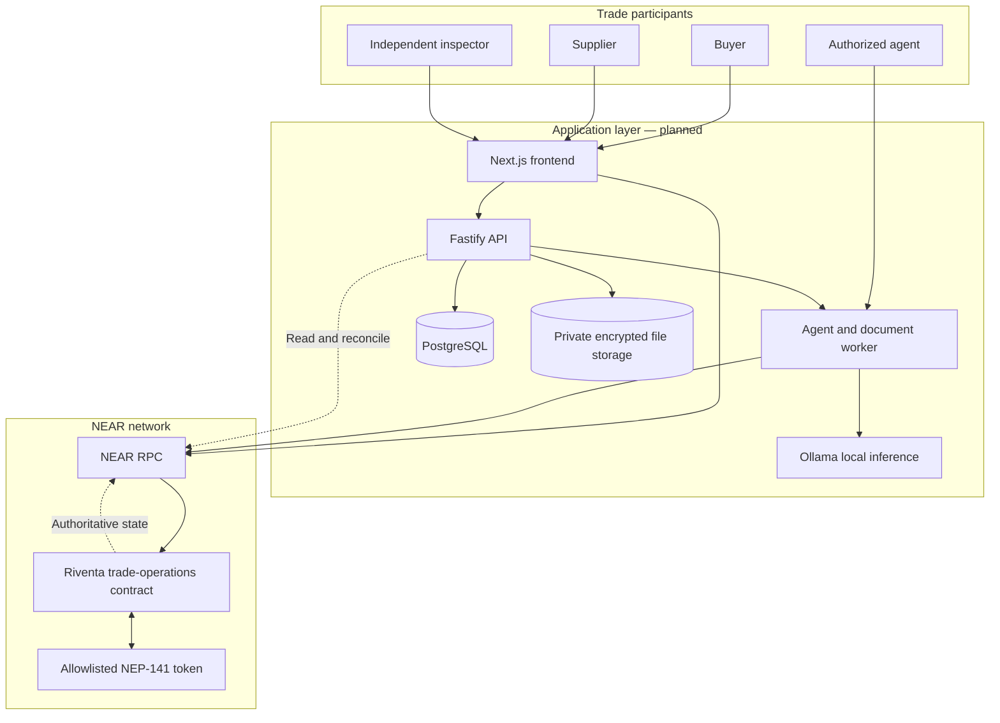
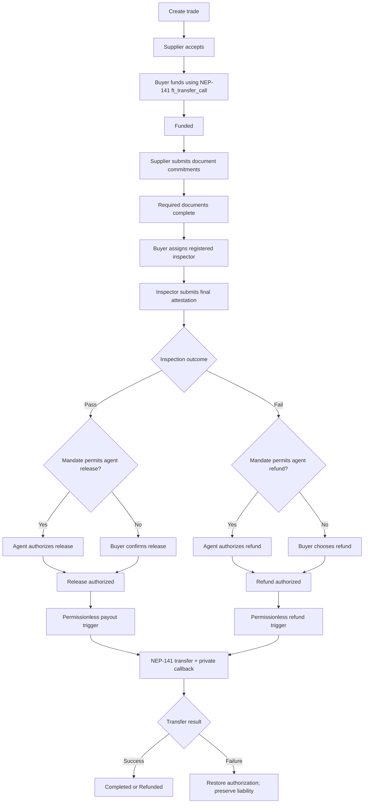
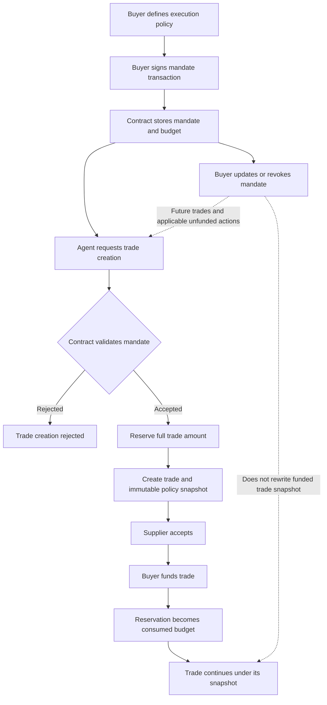

# Riventa

**Confidential Trade Operations and Conditional Settlement for Businesses**

Riventa is an AI-assisted trade-operations platform designed to coordinate cross-border business transactions through buyer-authorized automation, verifiable document commitments, independent inspection, and smart-contract-enforced escrow.

The system is designed around a clear separation of authority:

- Buyers define the limits under which an authorized agent may act.
- Suppliers accept trade terms and submit required documents.
- Independent inspectors attest to inspection outcomes.
- The NEAR smart contract enforces trade state, mandate permissions, budget accounting, and escrow settlement.
- Backend services process private documents and coordinate permitted operations without controlling customer funds.
- AI assists with document analysis; it does not authorize financial actions.

## Project status

**Current contract milestone:** `030c1d5` — `feat: add mandate-based execution and escrow settlement`

The Rust/NEAR contract currently implements:

- Three-administrator configuration with 2-of-3 administrative approval.
- Buyer-created trades and supplier acceptance.
- NEP-141 escrow funding through `ft_transfer_call`.
- Buyer-authorized execution mandates with update, renewal, and revocation.
- Agent-created trades constrained by mandate policy.
- Immutable per-trade mandate policy snapshots.
- Aggregate budget reservation and consumption accounting.
- Supplier document commitments with bounded versions.
- Inspector registration, status management, assignment, and replacement.
- Inspector pass/fail attestations.
- Buyer- or mandate-authorized payout/refund authorization.
- NEP-141 payout and refund transfers with asynchronous callbacks.

### Verification

The workspace passed the following checks on 7 November 2026:

| Check                                    |    Result |
| ---------------------------------------- | --------: |
| Contract unit tests                      | 87 passed |
| Funding and settlement integration tests |  3 passed |
| NEAR sandbox smoke tests                 |  1 passed |
| Rust formatting check                    |    Passed |
| Total tests                              | 91 passed |

Run the commands in [Development](#development) to reproduce the checks.

### Not yet implemented

The following remain outside the verified implementation milestone:

- Complete dispute opening, resolver decisions, and resolver replacement.
- Production backend API and agent-worker orchestration.
- Production frontend workflows.
- Wallet authentication and embedded-wallet integration.
- Private document storage, OCR, and AI document intelligence.
- Production deployment and operational monitoring.
- Live cross-chain settlement through NEAR Intents or Tidepool.

The architecture and requirements for these capabilities are documented, but they must not be confused with implemented or production-verified functionality.

---

## Table of contents

- [Problem and approach](#problem-and-approach)
- [System architecture](#system-architecture)
- [Trade lifecycle](#trade-lifecycle)
- [Mandates and delegated execution](#mandates-and-delegated-execution)
- [Technology stack](#technology-stack)
- [Smart-contract interface](#smart-contract-interface)
- [Escrow and settlement](#escrow-and-settlement)
- [Document commitments and inspection](#document-commitments-and-inspection)
- [Security model](#security-model)
- [Cross-chain direction](#cross-chain-direction)
- [Repository structure](#repository-structure)
- [Development](#development)
- [Documentation](#documentation)
- [Limitations and non-goals](#limitations-and-non-goals)

## Problem and approach

Cross-border trade involves multiple independent parties, sensitive commercial documents, inspection requirements, payment conditions, and operational coordination.

Traditional workflows often rely on disconnected communication channels, manual verification, and fragmented records. This makes it difficult to coordinate actions while preserving clear authorization and accountability.

Riventa approaches this problem through programmable trade operations:

1. A buyer defines a trade and, where applicable, delegates bounded execution authority to an agent.
2. The supplier accepts the trade.
3. The buyer funds the contract through an allowlisted NEP-141 token.
4. Required supplier documents are committed to the trade.
5. An assigned inspector submits a final inspection attestation.
6. The buyer or an authorized agent establishes the permitted settlement outcome.
7. Anyone may trigger an already-authorized payout or refund.
8. The contract records the asynchronous token-transfer result.

The smart contract enforces the financial and authorization rules. Off-chain services are intended to handle document processing, AI-assisted analysis, workflow orchestration, and read-model projections.

## System architecture

Riventa separates authoritative on-chain state from off-chain processing.



**Authority boundaries**

| Component       | Responsibility                                                                               | Authority                              |
| --------------- | -------------------------------------------------------------------------------------------- | -------------------------------------- |
| NEAR contract   | Mandates, trade state, budget accounting, escrow liabilities, inspection records, settlement | Authoritative                          |
| NEP-141 token   | Token balances and transfers                                                                 | Token ledger                           |
| Frontend        | Participant workflows and transaction preparation                                            | Non-authoritative                      |
| Backend/API     | Authentication, document processing, orchestration, indexing                                 | Non-authoritative                      |
| Agent worker    | Executes operations permitted by a mandate                                                   | Limited to contract-enforced authority |
| PostgreSQL      | Metadata, jobs, logs, and indexed projections                                                | Rebuildable                            |
| Private storage | Encrypted document objects and associated private data                                       | Off-chain evidence storage             |
| AI inference    | Explains structured document findings                                                        | Advisory only                          |

The backend, database, AI service, and frontend cannot independently authorize escrow transfers.

## Trade lifecycle

The implemented contract supports the core funding, document, inspection, authorization, and settlement flow.



The diagram describes the implemented funding and settlement paths. Dispute handling is part of the wider architecture, but its complete contract workflow is not included in the current verified implementation.

## Mandates and delegated execution

Riventa's mandate layer allows a buyer to authorize an agent to create trades and initiate specific settlement outcomes within explicit constraints.

A mandate binds:

- Buyer identity.
- Authorized agent account.
- Approved supplier.
- Supported payment token.
- Maximum amount per trade.
- Aggregate budget.
- Permitted release/refund outcomes.
- Expiry and policy version.

The buyer creates, updates, renews, or revokes a mandate through buyer-authorized contract calls.

### Mandate execution flow



### Budget accounting

For each mandate:

`aggregate_budget >= reserved_budget + consumed_budget`

The contract applies these rules:

- Trade creation reserves the full amount.
- Cancellation before successful funding releases the reservation exactly once.
- Successful funding converts the reservation into consumed budget.
- Failed or rejected funding does not consume budget.
- A post-funding refund does not automatically restore consumed budget.
- Contract-side accounting, not backend calculations, determines available budget.

### Immutable policy snapshots

Every mandate-created trade records the policy version, authorized agent, and settlement permissions that applied when the trade was created.

Later mandate updates do not rewrite existing snapshots.

Revocation prevents new agent-created trades and blocks applicable new agent actions on accepted but unfunded trades. Already-funded trades continue under their recorded policy snapshot.

The agent uses its own NEAR account. It does not sign as the buyer and does not directly control the buyer's escrowed tokens.

## Technology stack

The project distinguishes the verified contract toolchain from the planned application architecture.

| Layer               | Technology                                       | Status         |
| ------------------- | ------------------------------------------------ | -------------- |
| Smart contracts     | Rust 1.99.1                                      | Implemented    |
| NEAR SDK            | `near-sdk` 5.29.1                                | Implemented    |
| NEAR standards      | `near-contract-standards` 5.29.1                 | Implemented    |
| Integration testing | `near-workspaces` 0.23.0                         | Implemented    |
| Test token          | NEP-141 SDD token contract                       | Test workspace |
| Frontend            | Next.js 16.4.2, TypeScript 5.9.3                 | Planned        |
| Backend             | Node.js 26.13.0, Fastify 5.6.2, TypeScript 5.9.3 | Planned        |
| Database            | PostgreSQL 18.6                                  | Planned        |
| Document processing | `pdfjs-dist`, Tesseract.js                       | Planned        |
| AI inference        | Ollama with `qwen3:4b-instruct-2507-q4_K_M`      | Planned        |
| Job processing      | PostgreSQL-backed job table                      | Planned        |
| File storage        | Private encrypted filesystem storage             | Planned        |

The application-layer versions represent the selected architecture baseline, not evidence that the corresponding services are already implemented.

## Smart-contract interface

The current contract is implemented in:

`contracts/trade-operations/src/lib.rs`

The principal public methods are listed below. The source code is the authority for exact parameter and return types.

### Initialization and administration

| Method                  | Purpose                                                                              |
| ----------------------- | ------------------------------------------------------------------------------------ |
| `new`                   | Initializes the contract with three administrators and an allowlisted token contract |
| `propose_admin_action`  | Proposes an administrative action                                                    |
| `approve_admin_action`  | Records an administrator's approval                                                  |
| `execute_admin_action`  | Executes an approved administrative action                                           |
| `expire_admin_proposal` | Removes an expired proposal                                                          |
| `get_admin_proposal`    | Reads a proposal                                                                     |
| `get_contract_config`   | Reads contract configuration                                                         |

Administrative actions use a 2-of-3 approval model.

### Mandates and trade creation

| Method                       | Purpose                                     |
| ---------------------------- | ------------------------------------------- |
| `create_mandate`             | Creates buyer-authorized agent permissions  |
| `update_mandate`             | Updates mandate policy for future trades    |
| `renew_mandate`              | Renews mandate validity                     |
| `revoke_mandate`             | Revokes a mandate                           |
| `get_mandate`                | Reads mandate state                         |
| `get_trade_policy_snapshot`  | Reads a trade's stored policy snapshot      |
| `create_trade`               | Creates a buyer-originated trade            |
| `create_trade_under_mandate` | Creates a trade using an authorized mandate |
| `accept_trade`               | Allows the named supplier to accept         |
| `cancel_trade`               | Cancels an eligible unfunded trade          |

### Documents and inspection

| Method                                     | Purpose                                        |
| ------------------------------------------ | ---------------------------------------------- |
| `record_document_commitment`               | Records a supplier document commitment         |
| `get_document_commitments`                 | Reads document commitments                     |
| `are_required_supplier_documents_complete` | Checks required supplier document completeness |
| `get_inspector`                            | Reads inspector registration                   |
| `assign_inspector`                         | Assigns an eligible registered inspector       |
| `replace_inspector`                        | Replaces an inspector within the allowed limit |
| `submit_inspection_attestation`            | Records the assigned inspector's final outcome |
| `get_inspection_record`                    | Reads inspection information                   |

### Settlement

| Method                            | Purpose                                              |
| --------------------------------- | ---------------------------------------------------- |
| `authorize_mandated_release`      | Authorizes payout under the stored mandate snapshot  |
| `authorize_mandated_refund`       | Authorizes refund under the stored mandate snapshot  |
| `confirm_release`                 | Records buyer payout confirmation                    |
| `choose_refund`                   | Records buyer refund choice                          |
| `release_payment`                 | Triggers an authorized payout                        |
| `refund_escrow`                   | Triggers an authorized refund                        |
| `on_settlement_transfer_complete` | Processes the private asynchronous transfer callback |
| `get_trade`                       | Reads trade state                                    |

The token receiver `ft_on_transfer` is implemented through the NEP-141 fungible-token receiver interface.

## Escrow and settlement

### Funding

The buyer funds a trade through the allowlisted token contract's `ft_transfer_call`.

The receiver validates:

- The calling token contract.
- The original token sender.
- The stored buyer identity.
- The trade state.
- The exact required funding amount.
- The funding deadline.
- The contract's pause state.
- The bounded transfer message.

Rejected transfers return the full unused amount through NEP-141 transfer-call resolution. The contract does not manually refund a rejected incoming transfer.

The current test configuration uses a fixed funding amount of 10,000 SDD, represented as `10,000,000,000` raw units. SDD is a sandbox/test token and does not represent real purchasing power or revenue.

### Outgoing settlement

Payout and refund are separate authorization and execution steps.

1. A buyer or permitted agent establishes the authorization.
2. The contract records a unique settlement ID and pending settlement record.
3. A permissionless caller may trigger the authorized transfer.
4. The contract invokes the NEP-141 token transfer.
5. A private callback validates the promise result and settlement identity.
6. Successful transfers finalize the trade.
7. Failed transfers restore the relevant authorization and preserve the escrow liability for retry.

The callback is protected against stale or replayed settlement results. A missing or unknown promise result must not be interpreted as successful payment.

The agent authorizes within its mandate; the contract itself performs the token transfer.

## Document commitments and inspection

The current contract records supplier document commitments rather than storing document contents on-chain.

The implemented workflow includes:

- Required supplier document commitments.
- A 32-byte commitment requirement.
- Immutable first versions and append-only subsequent versions within the bounded version limit.
- Required-document completeness checks.
- Registered inspector eligibility and status checks.
- Buyer assignment of an active inspector.
- One permitted inspector replacement before attestation.
- Assigned-inspector-only final pass/fail attestation.

Document commitments provide a cryptographic reference to off-chain material. They do **not** independently prove that a document is authentic, legally valid, or factually correct.

The planned backend will manage private document storage, encryption, extraction, deterministic comparisons, and AI-assisted explanations. Those capabilities are not yet part of the verified contract milestone.

## Security model

Riventa is designed around explicit trust boundaries and contract-enforced invariants.

### Authorization

- Buyer actions require the buyer account.
- Supplier acceptance requires the named supplier.
- Inspector attestations require the assigned active inspector.
- Agent actions require the authorized agent and mandate or trade snapshot.
- Administrative actions require the configured multisig threshold.
- Backend sessions and AI output cannot replace contract authorization.

### Escrow integrity

- Only the allowlisted token contract may invoke the funding receiver.
- The original sender must be the buyer.
- Funding must match the required amount and deadline.
- Outgoing settlement must be authorized before execution.
- Failed outgoing transfers preserve the liability and restore the authorization path.
- Allocated escrow is not available for administrative withdrawal.

### Mandate integrity

- The contract validates agent identity and mandate constraints.
- Budget reservations prevent aggregate-budget oversubscription.
- Existing trade snapshots are not rewritten by later mandate changes.
- Revocation does not silently invalidate an already-funded trade.
- The agent cannot directly transfer customer escrow.

### Privacy

- Document contents and evidence files are not stored directly on-chain.
- On-chain commitments are fixed-size hashes.
- The planned backend uses private encrypted document storage.
- AI is intended to process structured findings and explain potential inconsistencies, not make binding financial decisions.

### Deployment assumptions

The contract source has no upgrade method. The deployment design calls for removing the temporary deployer full-access key after deployment and code-hash verification. These operational deployment controls must be verified on the actual deployed account; source code alone does not prove that a deployed account has no full-access key.

## Cross-chain direction

NEAR Intents is being evaluated as an optional cross-chain asset-routing layer.

The proposed direction is to let a user access supported external assets through an embedded-wallet experience, route assets through a cross-chain service, and ultimately fund Riventa's NEP-141 escrow on NEAR.

This is separate from the core trade and mandate contract.

The Tidepool sandbox work has included dry-quote experimentation, but a dry quote is not a completed deposit, swap, delivery, or refund.

The following remain unverified or unimplemented:

- End-to-end embedded-wallet signing compatibility.
- Chain Signatures integration.
- Live Intents deposit and outbound settlement.
- Destination-chain transaction and token-transfer verification.
- Replay protection and reconciliation for cross-chain execution.
- Production asset/network support and recovery behavior.

ADR-010 remains proposed. Do not treat cross-chain settlement as a production capability or as a prerequisite for the current NEP-141 escrow workflow.

## Repository structure

```text
riventa/
├── contracts/
│   ├── README.md
│   └── trade-operations/
│       ├── Cargo.toml
│       └── src/
│           ├── lib.rs
│           └── state.rs
├── test-contracts/
│   └── sdd-token/
├── integration-tests/
│   └── tests/
│       ├── funding_flow.rs
│       └── sandbox_smoke.rs
├── backend/
│   └── README.md
├── frontend/
│   └── README.md
├── docs/
│   ├── decisions/
│   ├── diagrams/
│   ├── implementation/
│   ├── 01-project-overview.md
│   ├── 02-problem-and-solution.md
│   ├── 03-product-requirements.md
│   ├── 04-system-architecture.md
│   ├── 05-trust-boundaries-and-privacy.md
│   ├── 06-trade-lifecycle.md
│   ├── 07-smart-contract-design.md
│   ├── 08-data-model-and-storage.md
│   ├── 09-security-model-and-invariants.md
│   ├── 10-ai-document-intelligence.md
│   ├── 11-backend-and-integration.md
│   ├── 12-mvp-scope-and-roadmap.md
│   ├── DECISION-REGISTER.md
│   └── INDEX.md
├── Cargo.toml
├── rust-toolchain.toml
└── README.md
```

## Development

### Requirements

- Rust toolchain `1.99.1`.
- `rustfmt` and `clippy` components.
- The `wasm32-unknown-unknown` target for contract WASM builds.
- Cargo.

The workspace uses the toolchain specified in `rust-toolchain.toml`.

### Clone

```bash
git clone https://github.com/Gidy515/Riventa-finance-.git Riventa
cd Riventa
```

### Install the WASM target

```bash
rustup target add wasm32-unknown-unknown
```

### Format

```bash
cargo fmt --all
cargo fmt --all -- --check
```

### Run the complete test suite

```bash
cargo test --workspace
```

The integration tests use `near-workspaces` and a local NEAR sandbox environment.

### Build the contract

```bash
cargo build \
  -p riventa-trade-operations \
  --target wasm32-unknown-unknown \
  --release
```

The resulting WASM artifact is produced under:

```text
target/wasm32-unknown-unknown/release/
```

### Validate the working tree

```bash
git diff --check
```

For a reproducible milestone, record the commit hash and test output alongside any deployment artifact.

## Documentation

The `docs/` directory contains the detailed project specifications, architectural decisions, security invariants, and implementation guidance.

Start with:

- [Documentation index](docs/INDEX.md)
- [Project overview](docs/01-project-overview.md)
- [System architecture](docs/04-system-architecture.md)
- [Trust boundaries and privacy](docs/05-trust-boundaries-and-privacy.md)
- [Trade lifecycle](docs/06-trade-lifecycle.md)
- [Smart-contract design](docs/07-smart-contract-design.md)
- [Security model and invariants](docs/09-security-model-and-invariants.md)
- [AI document intelligence](docs/10-ai-document-intelligence.md)
- [Backend and integration](docs/11-backend-and-integration.md)
- [MVP scope and roadmap](docs/12-mvp-scope-and-roadmap.md)
- [Decision register](docs/DECISION-REGISTER.md)

Relevant architectural decisions:

- [ADR-009 — Customer mandates and agent execution](docs/decisions/ADR-009-customer-mandates-and-agent-execution.md)
- [ADR-010 — NEAR Intents cross-chain settlement](docs/decisions/ADR-010-near-intents-cross-chain-settlement.md)

ADR-009 is accepted. ADR-010 remains proposed and does not change the approved core escrow implementation.

**Documentation reconciliation note:** Some detailed lifecycle and contract-design sections still contain older method names or describe features that have not reached implementation. For the current public API and implementation status, use the contract source and the verified milestone described in this README until those specifications are reconciled.

## Limitations and non-goals

The current milestone is a hackathon-stage contract implementation, not a production trade-finance deployment.

In particular:

- A document hash proves commitment consistency, not document authenticity.
- An inspection attestation is an authorized inspector's recorded claim, not an oracle proving physical-world events.
- A wallet account is not, by itself, legal identity or KYB verification.
- AI findings are advisory and may be incorrect or incomplete.
- PostgreSQL and backend state are not authoritative escrow records.
- SDD is a test token and has no represented monetary value.
- Dispute resolution is not yet implemented in the current contract interface.
- NEAR Intents/Tidepool cross-chain settlement is not live or production-verified.
- Production deployment, monitoring, operational key management, and recovery procedures require further work.

Riventa's central security principle is that **automation may operate within authority granted by a buyer, but it cannot create its own authority or bypass the smart contract's financial controls.**
